<!-- Referência visual: https://github.com/abhisheknaiidu/awesome-github-profile-readme -->

  

  
  

## Sobre mim

Sou graduando em Ciência e Tecnologia na UFMA e tenho experiência em desenvolvimento de software e automação de processos. Uso **Python** para automatizar rotinas e **TypeScript com NestJS** para construir APIs e integrar sistemas.

Já trabalhei com processamento em filas, tarefas agendadas e bancos de dados relacionais. Na graduação, estudo algoritmos e estruturas de dados em **C** e aplico padrões de projeto em **Java**.

Também tenho experiência com **Unity** e **C#**.

## Em foco

Atuo na Digisystem (EQT LAB) com automação de processos e RPA, desenvolvendo rotinas em Python e APIs em NestJS.
Estou aprofundando meus conhecimentos em desenvolvimento backend e arquitetura de software.

## Linguagens e ferramentas

**Linguagens**

**Backend, automação e ambiente**

Também uso **TypeORM**, **Bull**, **n8n**, **BotCity** e **pandas**.

## Contato

- [LinkedIn](https://www.linkedin.com/in/matheus-costa-90b5ba228)
<!-- E-mail: substitua [EMAIL] e retire o comentário para publicar.
- E-mail: [EMAIL]
-->
